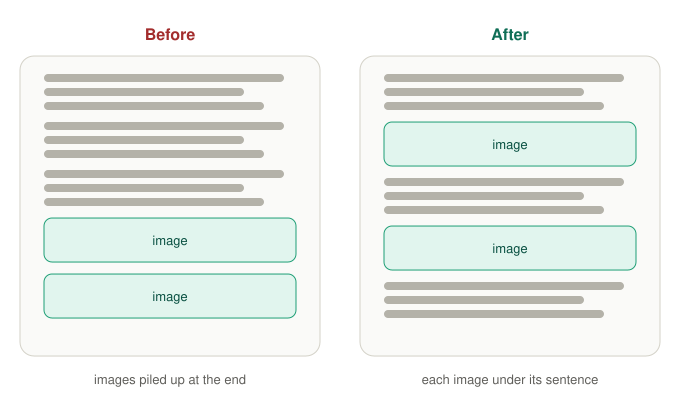

# Claude inline images 🖼️

**Make Claude put each image exactly where it belongs in its answer, right under the sentence it explains, instead of piling every picture up at the end.**

A tested method, a ready-to-use skill and two small scripts.

[English](#english) · [Français](#français)

<p align="center"></p>

---

## English

### The problem

You ask Claude to explain something with diagrams. It writes the text, and the images arrive **all at the end**, as attachments. You read a paragraph, scroll down, and no longer know which picture goes with which idea.

### Why it happens

- Images sent as **file attachments** are placed by the app, not by Claude. Usually at the end.
- Only two things appear **exactly where Claude calls them**: the chat's drawing tool (the *Visualizer*) and *image search*.

So the trick is to send every image **through the Visualizer**.

### What we tested (Claude app, November 2026)

| Method | Appears in place? | Speed | Verdict |
|---|---|---|---|
| Image sent as a file attachment | ❌ grouped at the end | fast | avoid in explanations |
| `` in the Visualizer, image hosted on GitHub via **jsDelivr** | ✅ | **instant** (one line) | **best** |
| Your own SVG pasted into the Visualizer | ✅ | 20–40 s per diagram | good fallback |
| Diagram drawn from scratch in the Visualizer | ✅ | slow | for new diagrams |
| Image embedded as `data:` (base64) | ✅ | very heavy | tiny images only |
| Image search | ✅ | instant | good extra |

Other image hosts are blocked by the Visualizer's security rules. `cdn.jsdelivr.net` is allowed, and it serves any file from a **public** GitHub repo.

### The best method in 4 steps

1. **Put your diagrams in a public GitHub repo** (SVG or PNG), one folder per chapter. Give SVGs a white background inside the file, so they stay readable in dark mode.
2. **Name each file with a hash of its content** (`fig06-6ba08680.svg`). If a diagram changes, it gets a new name: the CDN never shows an old version.
3. **Keep an index** (`index.json` or one `README.md` per chapter) with each diagram's caption and URL, so Claude picks the right one.
4. **Install the skill** [`inline-images`](skills/inline-images/SKILL.md). Claude then writes the text of one part, shows its diagram with a single line, and goes on:

```html
/<repo>@main/<chapter>/fig06-6ba08680.svg" style="max-width:100%;border-radius:12px">
```

### What's inside

| File | What it does |
|---|---|
| [`skills/inline-images/SKILL.md`](skills/inline-images/SKILL.md) | The rules: each visual in its place, never as an attachment, where to take it from, in which order |
| [`scripts/figure_to_chat.py`](skills/inline-images/scripts/figure_to_chat.py) | Lists the SVG diagrams of an HTML page and exports one as a standalone SVG with its colors inlined |
| [`scripts/build_bank.py`](skills/inline-images/scripts/build_bank.py) | Builds a whole image bank from HTML pages: hashed file names, `index.json`, one README per page |

Scripts need `pip install playwright && playwright install chromium`.

### Install the skill

- **Claude app:** zip the `skills/inline-images` folder (or take it from [Releases](../../releases)), then Settings → Skills → upload.
- **Claude Code:** `cp -r skills/inline-images ~/.claude/skills/`

### Limits

- The repo must be **public** (jsDelivr only serves public repos). Never put copyrighted figures there (textbooks, slides): redraw them instead.
- The Visualizer must be available in your Claude app.
- Tested in November 2026: the app's security rules may change.

### Related

- [claude-explain-like-chatgpt](https://github.com/alxhe3-lab/claude-explain-like-chatgpt): skills that make Claude explain as clearly as ChatGPT. They use this method.

If it helps you, a ⭐ helps others find it. *Not affiliated with Anthropic.*

---

## Français

### Le problème

Tu demandes à Claude une explication avec des schémas. Il écrit le texte, et les images arrivent **toutes à la fin**, en pièces jointes. On ne sait plus quelle image va avec quel paragraphe.

### Pourquoi

- Les **pièces jointes** sont placées par l'app, pas par Claude : souvent à la fin.
- Seuls l'**outil de dessin du chat** (le Visualiseur) et la **recherche d'images** s'affichent exactement là où Claude les appelle.

L'astuce : faire passer chaque image **par le Visualiseur**.

### La méthode en 4 étapes

1. Mets tes schémas dans un dépôt GitHub **public** (SVG ou PNG), avec un fond blanc dans chaque SVG.
2. Mets une empreinte du contenu dans le nom de chaque fichier (`fig06-6ba08680.svg`).
3. Garde un index avec la légende et l'adresse de chaque schéma.
4. Installe le skill [`inline-images`](skills/inline-images/SKILL.md) : Claude écrit une partie, affiche son schéma en une ligne ``, puis continue.

### Ce qu'on a testé

- Pièce jointe : à la fin. ❌
- `` hébergée sur GitHub et servie par jsDelivr : à sa place, instantané. ✅ **La meilleure.**
- SVG recopié dans le Visualiseur : à sa place, plus lent. ✅
- Image intégrée en `data:` : à sa place, mais très lourd. ✅ petites images seulement.

**Limite :** le dépôt doit être public. Jamais de figures sous droits d'auteur (manuels, diapos) : on les redessine.

Si ça t'aide, une ⭐ aide d'autres à le trouver.
